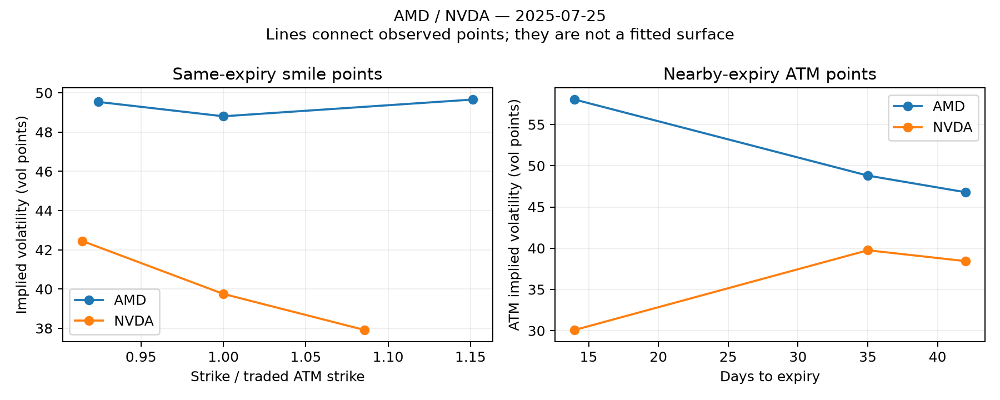

# Option smile and term structure states

Actual option-chain features added to the recent-refit model. The historical return skewness/kurtosis experiment is not included here. Each stock receives four surface attributes, and the pair receives their differences; every value also has an availability flag.

- Downside skew: lower-strike call IV near 0.75 call delta minus the traded ATM contract IV, at exactly the same expiry.
- Smile curvature: mean IV of lower/upper strikes near 0.75/0.25 call delta minus that ATM IV.
- Term slope: (longer ATM IV − shorter ATM IV) × 30 / actual calendar-day expiry gap. Shorter expiry is nearest 15 days within 8–22 days; longer is nearest 45 within 35–55 days. They must strictly bracket the traded expiry.
- Term bend: traded ATM IV minus linear interpolation between the two neighboring ATM IVs at its actual maturity. This is local IV curvature, not a fitted arbitrage-free surface or a risk-neutral fourth moment.

Quality and timing: standard 100-share calls, positive bid, uncrossed quotes, bid/ask width ≤25% of midpoint, and signal-close open interest ≥100. Wing candidates use vendor delta within 0.10 of the target; after midpoint Black–Scholes inversion they must still pass that delta tolerance and lie on the correct side of the ATM strike. ATM neighbors use the nearest strike within 10% of spot. Ties are deterministic. No wing extrapolation, stale-quote filling or interpolation across dates. Missing surface features become zero plus an explicit unavailable flag.

All selected points are refitted from their midpoints using the same declared-dividend escrow, rates and European-call approximation as the existing simulator. The archive contains calls only: lower-strike call IV is a downside proxy, not directly observed put skew. American early-exercise effects and approximate wing deltas remain limitations. Expiries are approximate, not exact constant-maturity 15/30/45-day contracts.

Model and accounting controls: same actual-contract rewards, monthly recent five-year training, completed-outcome purge, sizing, transaction costs, beta eligibility and risk limits. Independent RL ladder decisions and fixed-size/flat NN are retained. The original validation enable gates are held fixed; they do not independently validate the added features or newly refitted weights. Filtered variants retain the previously selected profitability rules without retuning.

Attempted all 358 pairs; 2 have an unresolved evaluation in at least one compared policy. Tables use matched complete rosters and retain cash-only sleeves. Ex-post coverage selection can be biased. The development and later periods have already been inspected; these are exploratory results, not an untouched holdout.

| Model | Variant | Period | Pairs | Return | Excess vs cash | Annualized excess Sharpe |
|---|---|---|---:|---:|---:|---:|
| rl_sized | previous_filtered | development_2018_2021 | 348 | 5.112% | 0.015% | 0.242 |
| rl_sized | previous_filtered | later_2022_2025 | 348 | 15.875% | -0.034% | -0.513 |
| rl_sized | previous_filtered | full | 348 | 21.799% | -0.018% | -0.131 |
| rl_sized | refit | development_2018_2021 | 348 | 5.093% | -0.005% | -0.048 |
| rl_sized | refit | later_2022_2025 | 348 | 15.799% | -0.110% | -0.973 |
| rl_sized | refit | full | 348 | 21.696% | -0.121% | -0.515 |
| rl_sized | refit_filtered | development_2018_2021 | 348 | 5.104% | 0.007% | 0.117 |
| rl_sized | refit_filtered | later_2022_2025 | 348 | 15.863% | -0.045% | -0.639 |
| rl_sized | refit_filtered | full | 348 | 21.777% | -0.039% | -0.278 |
| rl_sized | surface | development_2018_2021 | 348 | 5.075% | -0.022% | -0.224 |
| rl_sized | surface | later_2022_2025 | 348 | 15.805% | -0.103% | -0.947 |
| rl_sized | surface | full | 348 | 21.683% | -0.134% | -0.586 |
| rl_sized | surface_filtered | development_2018_2021 | 348 | 5.100% | 0.002% | 0.042 |
| rl_sized | surface_filtered | later_2022_2025 | 348 | 15.872% | -0.036% | -0.577 |
| rl_sized | surface_filtered | full | 348 | 21.782% | -0.035% | -0.265 |
| nn_fixed | previous_filtered | development_2018_2021 | 348 | 5.072% | -0.025% | -0.496 |
| nn_fixed | previous_filtered | later_2022_2025 | 348 | 15.852% | -0.057% | -0.711 |
| nn_fixed | previous_filtered | full | 348 | 21.728% | -0.089% | -0.607 |
| nn_fixed | refit | development_2018_2021 | 348 | 4.965% | -0.132% | -0.976 |
| nn_fixed | refit | later_2022_2025 | 348 | 15.742% | -0.166% | -1.477 |
| nn_fixed | refit | full | 348 | 21.489% | -0.327% | -1.186 |
| nn_fixed | refit_filtered | development_2018_2021 | 348 | 5.082% | -0.016% | -0.259 |
| nn_fixed | refit_filtered | later_2022_2025 | 348 | 15.877% | -0.032% | -0.436 |
| nn_fixed | refit_filtered | full | 348 | 21.765% | -0.051% | -0.350 |
| nn_fixed | surface | development_2018_2021 | 348 | 4.957% | -0.140% | -1.008 |
| nn_fixed | surface | later_2022_2025 | 348 | 15.784% | -0.125% | -1.083 |
| nn_fixed | surface | full | 348 | 21.523% | -0.294% | -1.036 |
| nn_fixed | surface_filtered | development_2018_2021 | 348 | 5.077% | -0.021% | -0.406 |
| nn_fixed | surface_filtered | later_2022_2025 | 348 | 15.892% | -0.016% | -0.200 |
| nn_fixed | surface_filtered | full | 348 | 21.776% | -0.041% | -0.279 |

Sharpe uses daily cash-excess returns and √252; total returns include interest. 2025 is partial. Smile and term structure are tested together in this first pass.

[Results](contract_surface_features/comparison.csv) · [Annual results](contract_surface_features/annual.csv) · [Activity](contract_surface_features/activity.csv) · [Coverage](contract_surface_features/coverage.csv) · [Unresolved](contract_surface_features/unresolved.csv)

Audit: 126 tests passed; original states, strict outcome timing, historical enable gates, beta eligibility, sizing ladders and profitability filters verified. Maximum ledger error 8.63e-10 dollars. 429 NN convergence warnings retained. Conservative two-worker peak-memory bound 1.17 GiB.

[Audit and eligible-signal coverage](contract_surface_features/audit.json)

The filtered surface NN improves later-period Sharpe to −0.200 from −0.436, while its development Sharpe worsens to −0.406 from −0.259. Filtered surface RL remains negative and does not beat the earlier filtered RL's full-period −0.131 Sharpe. This is mixed evidence, not recovered positive net alpha. The NN has 429 convergence warnings across 1,017 attempted refit decisions (three total model-months across both models lack sufficient recent history), materially limiting the comparison.

Both-leg feature coverage on beta-eligible signal rows is 30.9% for downside skew, 22.2% for smile curvature, and 38.6% for term slope/bend. Missingness flags preserve cash/trade decisions without fabricating a complete surface.

