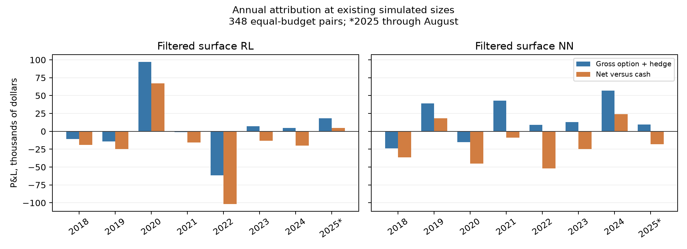

# What causes the current contract simulations to lose money?

All comparisons use the same 348 complete broad pairs, 2018–August 2025, at the existing $1 million budget per pair. Cash-only sleeves remain included; two unresolved histories are explicitly excluded. These are accounting diagnostics of saved policies, not a new strategy fit.

## Exact P&L components

Dollar amounts below are thousands of dollars across the entire configured portfolio and full period. Option and stock hedge P&L must be read together. Costs are shown as positive deductions. Financing is actual cash interest minus the interest on the matched idle-cash benchmark.

| Policy | Option mid P&L | Stock hedge P&L | Dividends | Option commission | Option penalty | Stock execution | Stock borrow | Financing vs cash | Net excess |
|---|---:|---:|---:|---:|---:|---:|---:|---:|---:|
| earlier_filtered_rl | -117.1 | 194.0 | 0.0 | 62.9 | 29.7 | 28.2 | 7.1 | -12.4 | -63.4 |
| surface_filtered_rl | -361.4 | 401.5 | 0.0 | 68.1 | 34.9 | 34.1 | 8.4 | -16.7 | -122.1 |
| surface_filtered_nn | -476.1 | 608.2 | 0.0 | 115.5 | 61.1 | 62.1 | 13.8 | -21.7 | -142.0 |

## Fixed-inventory cost bridge

Remove one cost or a stated combination while keeping the observed trades, hedges and exits fixed. Recompute cash financing exactly. These are diagnostic counterfactuals, not achievable strategy results; lower fees could change sizing, eligibility and risk exits in a fresh simulation. Sharpe is annualized from daily cash-excess returns using √252.

| Policy | Cost treatment | Full-period Sharpe | 2022–2025 Sharpe | Full-period excess dollars |
|---|---|---:|---:|---:|
| earlier_filtered_rl | net | -0.131 | -0.513 | $-63,431 |
| earlier_filtered_rl | no_option_penalty | -0.061 | -0.444 | $-29,683 |
| earlier_filtered_rl | no_option_commission | 0.017 | -0.387 | $8,180 |
| earlier_filtered_rl | no_option_costs | 0.086 | -0.318 | $41,928 |
| earlier_filtered_rl | no_execution_costs | 0.152 | -0.248 | $73,920 |
| earlier_filtered_rl | no_execution_or_stock_borrow | 0.168 | -0.231 | $81,996 |
| surface_filtered_rl | net | -0.265 | -0.577 | $-122,087 |
| surface_filtered_rl | no_option_penalty | -0.179 | -0.475 | $-82,563 |
| surface_filtered_rl | no_option_commission | -0.097 | -0.403 | $-44,668 |
| surface_filtered_rl | no_option_costs | -0.011 | -0.301 | $-5,144 |
| surface_filtered_rl | no_execution_costs | 0.073 | -0.202 | $33,560 |
| surface_filtered_rl | no_execution_or_stock_borrow | 0.093 | -0.178 | $43,117 |
| surface_filtered_nn | net | -0.279 | -0.200 | $-142,018 |
| surface_filtered_nn | no_option_penalty | -0.143 | -0.078 | $-72,746 |
| surface_filtered_nn | no_option_commission | -0.022 | 0.049 | $-11,125 |
| surface_filtered_nn | no_option_costs | 0.114 | 0.172 | $58,146 |
| surface_filtered_nn | no_execution_costs | 0.252 | 0.295 | $128,504 |
| surface_filtered_nn | no_execution_or_stock_borrow | 0.283 | 0.323 | $144,117 |

## Loss concentration

| Policy | Entries | Active pairs | Profitable net | Profitable before costs/funding | Five worst pairs’ share of losses | Five worst pairs |
|---|---:|---:|---:|---:|---:|---|
| earlier_filtered_rl | 514 | 55 | 25 | 33 | 64.4% | M/KSS; AMD/NVDA; CLF/FCX; RCL/NCLH; AMD/MU |
| surface_filtered_nn | 438 | 80 | 34 | 41 | 34.4% | HES/CVX; KKR/APO; THC/HCA; PENN/WYNN; BAC/C |
| surface_filtered_rl | 528 | 56 | 28 | 34 | 58.5% | AMD/NVDA; M/KSS; CLF/FCX; SPWR/CSIQ; RCL/NCLH |

The per-underlying file reconciles each option leg with its aggregate stock hedge, option/stock costs, stock borrow and dividends over complete lifecycles. Shared portfolio financing stays separate; leg P&L is not presented as standalone strategy profitability. Long/short counts describe option entries, and a leg can trade in both directions.

Exit-reason and holding-period tables describe observed behavior. They do not establish that a risk limit caused a loss: testing different exits requires a separate replay. Worst pair-day rows are mark-to-market attribution, not an allocation to individual overlapping cohorts.

[Components](current_contract_losses/components.csv) · [Cost bridge](current_contract_losses/cost_bridge.csv) · [Pair P&L](current_contract_losses/pairs.csv) · [Underlying legs](current_contract_losses/legs.csv) · [Annual components](current_contract_losses/annual_components.csv) · [Exit reasons](current_contract_losses/exits.csv) · [Worst pair-days](current_contract_losses/worst_pair_days.csv) · [Entry decisions](current_contract_losses/entry_decisions.csv)

## Interpretation

The latest filtered policies have positive but small gross option-plus-hedge P&L. Costs overwhelm that edge. Removing execution costs and stock borrow gives full-period fixed-inventory Sharpe of only 0.093 for surface RL and 0.283 for surface NN. The later-period RL remains negative at −0.178 even in that diagnostic. The earlier filtered RL similarly reaches only 0.168 over the full period. Thus execution costs explain the sign flip over the full history, but do not conceal a strong persistent gross signal.

For surface RL, gross hedged profit is 0.330 dollars per dollar of initial mean-leg vega (equivalently about 0.33 vol points). The deductions are 0.560 commissions, 0.287 option execution penalty, 0.280 stock execution, and 0.069 stock borrow, before the cash-benchmark financing difference. These are aggregate realized P&L/cost ratios, not predicted trade edges or actual quoted bid/ask widths.

The current filtered RL loses $75,271 in AMD/NVDA and $44,282 in M/KSS over the full period. The five worst pairs contribute 58.5% of gross pair losses. Its 2022 gross hedged loss is $61,627 before costs, versus a $97,165 gross gain in 2020. The weakness is therefore also pair- and regime-specific.

A concrete jump-risk example: on January 24, 2022 the filtered surface RL held long Macy’s calls and short Kohl’s calls. In our underlying data Macy’s rose 18.0% and Kohl’s 36.0% close-to-close. The KSS leg lost $73,326 after its stock hedge, while M gained $23,596, leaving a gross pair loss of $49,730 and net loss of $49,879. Kohl’s confirmed acquisition interest that day in its [company announcement](https://investors.kohls.com/news/news-details/2022/Kohls-Confirms-Receipt-of-Expressions-of-Interest/default.aspx). Daily delta hedging and initial vega neutrality did not offset this relative jump.

There is also quote-mark noise. On November 20, 2024 a held PENN call’s bid/ask widened from $1.26/$1.30 to $1.04/$2.22. Its midpoint-fit IV jumped from 45.6% to 69.3%, and the PENN/CZR book lost $22,848. The next day the same call quoted $1.12/$1.18 and the book gained $22,990. This reversal shows why individual daily losses and Sharpe/drawdown estimates need quote-quality scrutiny; it does not explain the cumulative loss by itself. Held quotes are currently marked at mid without the 25% relative-width entry filter.

The worst-day contract decomposition exactly reconstructs the saved prior hedge. It separates repricing at the old IV with current spot/time/rate/known dividends from the residual to the observed new midpoint. This is a path-dependent accounting decomposition, not a clean causal Greek regression. For rows without valid IV at both endpoints, the residual must not be called an IV-change effect.

### Actual holding periods

| Policy | Entries | Planned hold, days | Actual hold, days | Exited before planned date |
|---|---:|---:|---:|---:|
| earlier_filtered_rl | 514 | 27.32 | 19.00 | 68.9% |
| surface_filtered_rl | 528 | 27.36 | 18.76 | 67.8% |
| surface_filtered_nn | 438 | 27.60 | 18.59 | 70.1% |

Early exits above compare actual and scheduled dates. Exit reason alone is insufficient: a missing-Greek or dividend tag can coincide with the scheduled day. The standalone training labels include dividend and missing-Greek exits, but exclude overlapping-book risk limits; frequent portfolio risk exits create a remaining training/deployment reward mismatch.

All invalid-Greek legs triggering exits in the three filtered policies have midpoint prices at or below the European model’s lower bound. For current surface RL there are 88 affected cohorts, with 98 invalid legs and median 7 days to expiry. Quote synchronization and the pricing/dividend approximation need investigation. These forced liquidations are a simulation assumption; whether alternative treatment improves P&L requires a controlled replay, not arbitrary replacement marks.

The cash-interest difference is not entirely a borrowing charge. It also includes reduced interest earned after prior trading losses. The funding table separates position funding, compounding of previous P&L versus cash, and any negative-cash surcharge.

Priorities supported by this diagnosis: audit wide held marks and invalid-Greek handling; align training rewards with actual overlapping-book exits; demand enough expected net edge to cover the complete cost budget; and examine the identified jump/relative-IV losses before adding further states. These findings do not justify deleting losing pairs or dates retrospectively.

[Vega-normalized components](current_contract_losses/vega_normalized_components.csv) · [Actual versus planned holds](current_contract_losses/holding_periods.csv) · [Financing decomposition](current_contract_losses/funding_summary.csv) · [Greek-exit quote diagnosis](current_contract_losses/missing_greek_reasons.csv) · [Worst-day contracts](current_contract_losses/worst_day_contracts.csv)

Verification: 129 tests passed, including independent ledger fixtures with split adjustments. All diagnosed complete books reconcile daily to less than $0.000001. No policies, costs, marks or risk limits were changed by this analysis.

