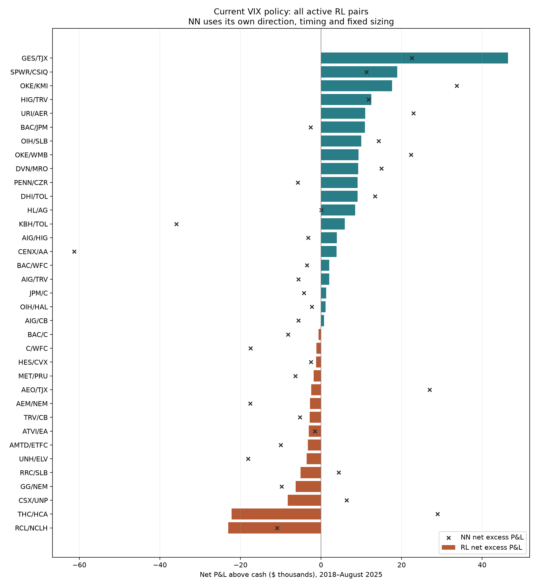

# Current VIX model: which pairs drive performance?

The matched universe contains 346 pairs, but RL trades only 35: 20 finish profitable and 15 lose, across 280 accepted entries. Net excess P&L is $105,789. The other 311 pairs stay in cash under the existing policy and gates; their inactivity is not evidence that their potential strategies are unprofitable.

This analysis uses the user-selected VIX-only reference, beta 0.85–1.15, unchanged execution costs and hold-to-expiry accounting. Pair labels are the saved research labels and can reflect historical tickers. All outcomes are exploratory and already inspected.

## Largest winners and losers

| Pair | RL entries | RL net excess P&L | RL annualized excess Sharpe | NN net excess P&L |
|---|---:|---:|---:|---:|
| GES/TJX | 13 | $46,416 | 0.360 | $22,586 |
| SPWR/CSIQ | 5 | $18,890 | 0.205 | $11,288 |
| OKE/KMI | 12 | $17,603 | 0.354 | $33,710 |
| HIG/TRV | 11 | $12,496 | 0.421 | $11,770 |
| URI/AER | 7 | $10,947 | 0.403 | $22,925 |
| RCL/NCLH | 6 | $-23,047 | -0.496 | $-10,891 |
| THC/HCA | 19 | $-22,195 | -0.108 | $28,944 |
| CSX/UNP | 13 | $-8,263 | -0.426 | $6,361 |
| GG/NEM | 5 | $-6,285 | -0.063 | $-9,788 |
| RRC/SLB | 1 | $-5,107 | -0.253 | $4,414 |

## Concentration

Profitable RL pairs contribute $193,348, offset by $87,559 from losing pairs. GES/TJX contributes 24.0% of positive-pair profit; the top three contribute 42.9%. The top five account for essentially the entire final net profit.

| Diagnostic | Annualized excess Sharpe | Net excess P&L |
|---|---:|---:|
| Full current portfolio | 0.226 | $105,789 |
| Replace top 1 pairs with cash | 0.132 | $59,374 |
| Replace top 3 pairs with cash | 0.053 | $22,881 |
| Replace top 5 pairs with cash | -0.001 | $-562 |

These are hindsight concentration diagnostics. They retain the original capital allocation and replace removed sleeves with their cash benchmarks. They are not proposed selection rules or retrained portfolios.

## Pair quality versus policy quality

The five largest RL winners also profit under the NN, which is useful agreement, although the models share inputs, costs, training history and gates. Across the 35 pairs traded by both models, 10 profit in both, 11 lose in both and 14 disagree in sign. THC/HCA is −$22.2k for RL but +$28.9k for NN; CSX/UNP is −$8.3k versus +$6.4k. RCL/NCLH loses in both. Pair identity alone therefore does not explain the losses; direction, entry timing and size matter.

## Do observable pair characteristics separate winners?

| Entry characteristic | Winner median | Loser median | Rank correlation with pair Sharpe |
|---|---:|---:|---:|
| Absolute beta distance from one | 0.080 | 0.087 | -0.103 |
| Stock-return correlation | 0.777 | 0.773 | 0.060 |
| Mean contract IV (vol points) | 35.166 | 32.542 | -0.099 |
| Absolute contract IV spread (vol points) | 4.372 | 5.053 | -0.012 |
| Expiry gap (days) | 1.391 | 2.500 | -0.076 |
| Fraction of entries with earnings inside 30 days | 0.431 | 0.316 | 0.074 |
| Fraction shorting the higher-IV leg | 0.550 | 0.333 | 0.139 |
| Previous-close VIX | 18.860 | 19.765 | -0.124 |

These are pair-level means measured only on accepted entry dates, then compared across active pairs. They are descriptive associations, not causal effects or independent significance tests. The narrow existing beta/correlation gates restrict what can be learned about excluded pairs. There is no strong monotonic separator here. In particular, RCL/NCLH loses despite roughly 0.929 stock-return correlation, while GES/TJX wins with roughly 0.598. Higher correlation alone is not sufficient.

## Costs, tails and stability

Only 3 of 15 RL losers are gross-positive before execution, borrow and financing: BAC/C, C/WFC and AEO/TJX. The other 12 already lose before those charges. Costs are not the main explanation for most losing pairs.

7 of the 15 losers would be positive if their worst daily mark were deleted, but only 2 would be positive excluding their worst year. Deleting a day is not a tradable counterfactual: it changes the marked path and can remove a temporary quote move without changing terminal economics. RCL/NCLH still loses after excluding its worst day, and its six RL entries all occur in 2023. THC/HCA loses about $21.9k in 2022, but its NN profits overall, so it should not simply be blacklisted based on the RL result.

Median accepted entries per active RL pair: 7; 15 of 35 have five or fewer. Median number of entry years: 1. Only 5 pairs have entries in both 2018–2021 and 2022–2025, too few for a reliable persistence conclusion. Counts are overlapping cohorts, not independent observations.

GES/TJX has 13 RL entries, all in 2022–2023. SPWR/CSIQ has five, all in 2021. URI/AER has seven across three entry years, and OKE/KMI is profitable in both models (its NN has 20 entries across five years). These are research candidates for validation, not established durable winners.

Net excess P&L includes interest on accumulated gains or losses relative to cash. A pair can therefore show small later-year P&L without new trades. The annual CSV separately reports net trading P&L before financing to distinguish this carry from new trading profit. Sharpe uses daily cash-excess returns and √252 over the full evaluation calendar, including flat periods.

## Next useful test

Keep the current universe while testing a causal pair-quality gate based only on completed historical shadow trades, with minimum independent-window coverage and performance stability. The existing directional 91/365-day profitability memory already filters entries; simply adding another past-profit mean would duplicate it. A useful extension would assess reliability across non-overlapping windows and penalize dependence on a few events, then validate subsequent performance on a fixed roster. Selecting the winners listed above using full-period results would overstate the opportunity.

[All pair metrics](current_pair_selection/pairs.csv) · [Year-by-year P&L](current_pair_selection/annual.csv) · [Entry characteristics](current_pair_selection/entries.csv) · [Concentration](current_pair_selection/exclusions.csv) · [Feature associations](current_pair_selection/associations.csv) · [Industry groups](current_pair_selection/industries.csv)

Verification: each pair’s daily excess P&L reconciles to terminal NAV less its cash benchmark; aggregate totals and Sharpe match the saved VIX comparison. No model was retrained and no trading policy was changed for this diagnosis.

## Why only 35 pairs trade

| Cumulative eligibility stage | Pairs with any opportunity | Pair-signal dates |
|---|---:|---:|
| Usable dates within historical membership | 285 | 154,319 |
| Beta/correlation eligible | 128 | 28,884 |
| Also passes memory in at least one direction | 112 | 11,227 |
| Also has an enabled validation month | 37 | 2,342 |
| Final nonzero RL action | 35 | 1,360 |

The initial matched roster is 346 pairs. Historical membership and usable state coverage leave 285 with evaluation signal dates; 61 have none. These counts are not a count of all stock-calendar dates. The beta range is 0.85–1.15 with correlation ≥0.5. RL additionally requires positive directional net shadow payoff over both 91 and 365 days, with at least 21 and 63 completed observations respectively. A separate preceding-year validation must produce positive daily excess Sharpe; minimum training history also applies. These are hard vetoes in addition to the learned policy.

Of 1,360 nonzero RL signals, 280 enter, 582 hit entry risk limits, 338 are blocked while the held portfolio breaches risk limits, 93 lack an eligible entry quote, and 67 fail integer-contract vega matching. All 35 pairs with nonzero final actions have at least one accepted entry: execution/risk gates reduce frequency here, while the earlier screens explain the narrow pair breadth. Since positions remain held to expiry, daily repeated signals are not independent new opportunities.

Across RL pair-month fits, 5,199 have no prior-validation opportunities passing eligibility and directional memory, 1,619 fail the validation gate, 1,525 lack sufficient training, and 549 are enabled. The final-action count also combines policy-flat decisions with chosen directions rejected by memory; the saved outputs do not identify those two causes separately.

A clean participation experiment would keep beta eligibility, costs and risk limits fixed, retain profitability memory as model inputs, and compare the current hard directional profitability veto with a state-only version. This would test whether the stacked filters are suppressing useful opportunities without using full-period winners to select pairs. It is a proposed experiment, not a result or a policy change.

[Entry funnel](current_pair_selection/entry_funnel.csv) · [Monthly gates](current_pair_selection/fit_gates.csv) · [Execution rejections](current_pair_selection/execution_gates.csv)
