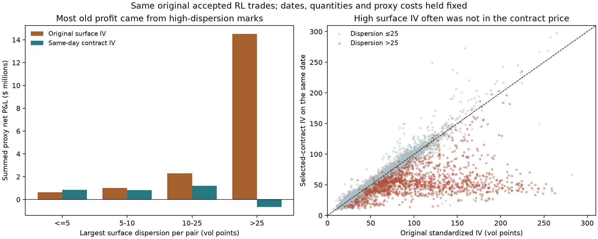

# Where the expiry strategy loses the old signal

The largest difference is a non-comparable IV input, not merely a larger execution penalty. The original model treated smoothed 30-day / 50-delta IV as an executable volatility premium. Much of its apparent profit is concentrated where those marks are very uncertain and far above actual contract IV. After removing that apparent premium, the current models have little gross edge; costs then make the results negative.

## 1. Original signal, identical trades, only the IV mark changes

This reconstruction uses 29,333 accepted original RL cohorts across the earlier 311-pair common roster and its fixed 1,835-date complete-outcome calendar. Dates, directions, initial mean vega, forward 30-day RV and original proxy costs are held fixed. These are summed proxy rewards, not financed portfolio returns. The new 347-pair expiry results below use different policies and must not be spliced into one causal P&L waterfall.

| Original accepted trades | Cohorts | Original proxy net | Contract-IV proxy net | Original proxy Sharpe | Contract-IV proxy Sharpe |
|---|---:|---:|---:|---:|---:|
| all | 29,333 | $18,443,305 | $2,213,090 | 1.430 | 0.244 |
| dispersion_at_most_5 | 23,795 | $626,810 | $840,132 | 0.092 | 0.118 |
| dispersion_at_most_10 | 26,103 | $1,636,787 | $1,649,594 | 0.214 | 0.207 |
| dispersion_above_25 | 1,836 | $14,503,138 | $-642,532 | 1.547 | -0.283 |
| tenor_2_days_delta_45_55 | 3,378 | $225,618 | $-578,931 | 0.076 | -0.225 |

Proxy Sharpe uses √(365/30), as in the original experiment. It is not the daily marked NAV Sharpe used for actual contracts. Quality restrictions here are descriptive subsets of frozen original decisions, with excluded trades set flat; these are not retrained or independently validated strategies.

Only 1,836 cohorts (6.3%) had maximum surface dispersion above 25 volatility points, but they generated $14.50m (78.6%) of the original $18.44m proxy net profit. Holding the old proxy costs fixed and substituting contract IV turns that group into a $0.64m proxy loss. The lower-dispersion majority retains some positive proxy reward, but its Sharpe is much smaller. The 1,556 cohorts with a standardized IV above 100 generated 69.3% of old net proxy profit and 74.3% of the IV-substitution correction.

The original source is OptionMetrics `vsurfd` via the prior monthly ATM-IV download. The [OptionMetrics reference manual, pp. 28–29](https://lib.tsinghua.edu.cn/PDF/OptionMetricsshiyongzhinan.pdf) describes a smoothed surface and identifies dispersion as an accuracy diagnostic: larger values indicate less reliable smoothing. Our old loader retained IV but discarded dispersion. This does not establish the precise vendor/version mechanism behind each extreme value, or prove every surface mark is wrong. It does establish that the proxy treated large surface/contract discrepancies as tradable premiums.

| Example | Original 30-day surface IV | Selected call IV | Vendor IV for that same call | Surface dispersion | Selected tenor |
|---|---:|---:|---:|---:|---:|
| SWN, March 9, 2021 | 222.56 | 68.44 | 68.44 | 92.29 | 38 days |
| KGC, March 6, 2024 | 190.88 | 39.03 | 39.03 | 76.62 | 30 days |

The nearby-chain check retains positive, uncrossed quotes, width ≤25%, OI ≥100, standard contracts, fitted delta 0.35–0.65 and 25–45 days to expiry. KGC has an exact 30-day quoted candidate; SWN’s comparable candidate is 38 days. Even the larger matched-tenor/matched-delta subset loses most proxy edge when its IV is replaced. Thus neither our BS inversion nor maturity mismatch alone explains the old discrepancy.

## 2. What actually loses money in the current model

On 347 common pairs, retrained RL earns $15,123 gross but pays $66,644 of option entry costs, $47,215 of hedge execution and $14,477 of stock borrow, plus −$16,273 financing versus cash. Net excess P&L is −$129,486. Only 22 of its 52 active pairs are profitable gross. The five worst losing pairs account for 48.1% of losses among losing pairs: HL/AG, AMD/NVDA, ATVI/EA, AMD/MU and THC/HCA.

With every option and stock execution cost removed, but identical trades/hedges and financing recomputed, RL daily excess Sharpe is approximately zero. Removing stock borrow as well raises it only to 0.026. NN remains negative at −0.072 even after removing all execution and stock-borrow costs. These are fixed-inventory diagnostics, not reoptimized cost-free strategies. Cost assumptions hurt, but they do not conceal a strong current gross policy.

Same actual retrained RL trades, using initial leg vegas and successive payoff approximations:

| Payoff calculation | Summed gross P&L |
|---|---:|
| Contract entry IV, original forward 30-day RV | $23,138 |
| Contract entry IV, each leg’s RV through actual expiry | $47,038 |
| Exact terminal payoff and daily hedge using fixed entry IV | $28,491 |
| Exact terminal payoff and the simulator’s daily-IV hedge | $15,123 |

The fixed-entry-IV hedge is a diagnostic alternative, not a new selected strategy. It keeps the same actual contracts and quantities, uses current spot/rates/declared-dividend PV and remaining time, but holds hedge-model volatility at its entry value. All figures above exclude execution costs and financing; the exact ledgers include hedge dividends. This shows that daily IV-driven hedge changes contribute about −$13,368 for these RL positions, but are much smaller than the old IV-source discrepancy and the current execution bill. The expiry-RV proxy and actual gross cohort P&L still have Spearman correlation 0.699: the proxy contains information, but its dollars are not exact option P&L.

## 3. Specific losing paths and expiry mismatches

On the January 4, 2019 ATVI/EA signal, the original proxy suggests +$5,692 gross. Entry was January 7: long ATVI calls with 25 days remaining and short EA calls with 39. ATVI settled February 1; EA stayed short until February 15. The original RV window stopped February 3, before EA fell 13.3% on February 6 and rose 16.1% on February 8. EA’s original-window RV was 34.3 versus 72.9 through the actual expiry; the pair lost $23,751 gross. Its unpaired tail after ATVI expired lost $26,985. This is a concrete horizon/gamma exposure difference, not an option exit spread.

The earnings state on that signal was 31 for both names: the old encoding caps days-to-earnings at 31. It cannot distinguish an event 32 days away from one much later, although the selected contracts can last up to 45 days. Actual-expiry earnings exposure is therefore not fully represented.

Different expiries affect 200 of 547 retrained RL cohorts and 229 of 746 NN cohorts. Unpaired tails contribute +$21,503 for RL but −$66,179 for NN. Maturity mismatch is important, especially for the NN, but it cannot explain all RL losses; enforcing identical expiries is not shown here to improve performance. HL/AG supplies a same-expiry counterexample: AG fell 22.6% on March 21, 2023, while the book was short its gamma, contributing to a $56,015 pair-day net loss across overlapping cohorts.

## 4. Retraining changed which trades were taken

Only 22 of 410 frozen RL cohort keys also appear among the 547 retrained entries; none of these common trades reversed direction. The 388 dropped cohorts had +$68,709 gross P&L. The 525 newly selected cohorts produce −$3,268 gross before their costs. This is a trade-selection change, not just the same positions becoming more expensive. For NN, the 715 new cohorts produce −$27,349 gross. These comparisons are descriptive and affected by changed sizing/entry acceptance; they are not independent estimates of future selection skill.

The current validation gate tests an earlier fitted proposal, then the permitted model is refitted using recent completed outcomes before deployment. The gate does not validate those exact refitted weights. That is a concrete modeling issue to isolate next, not a proven explanation of all the loss. NN nonconvergence is also frequent in the recorded fits.

## Implication

The old proxy’s strongest edge is not reliable evidence of executable relative-value profit. Some cleaner-data signal remains, and individual contract pairs do profit, but the old magnitude was substantially inflated by the surface marks. The next controlled work should use quote-backed IV on a consistent expiry, represent earnings through that actual expiry, and test the validated model versus the deployed refit with the same entry rules. More feature searches or cheaper costs would not address the largest identified discrepancy.

[Original quality scores](expiry_signal_gap/original_quality_proxy_scores.csv) · [Actual cost bridge](expiry_signal_gap/cost_bridge.csv) · [Pair attribution](expiry_signal_gap/pairs.csv) · [Cohorts](expiry_signal_gap/cohorts.csv) · [Legs](expiry_signal_gap/trade_legs.csv) · [Selection changes](expiry_signal_gap/selection_changes.csv) · [Nearby quote examples](expiry_signal_gap/example_nearby_contracts.csv)

Verification: every reconstructed cohort hedge sums to the saved aggregate hedge; per-day gross P&L sums to the ledger; unchanged-cost repricing reproduces NAV. The scripts are `diagnose_expiry_signal_gap`, `diagnose_original_iv_gap`, `diagnose_surface_quality`, and `report_expiry_signal_gap`.
